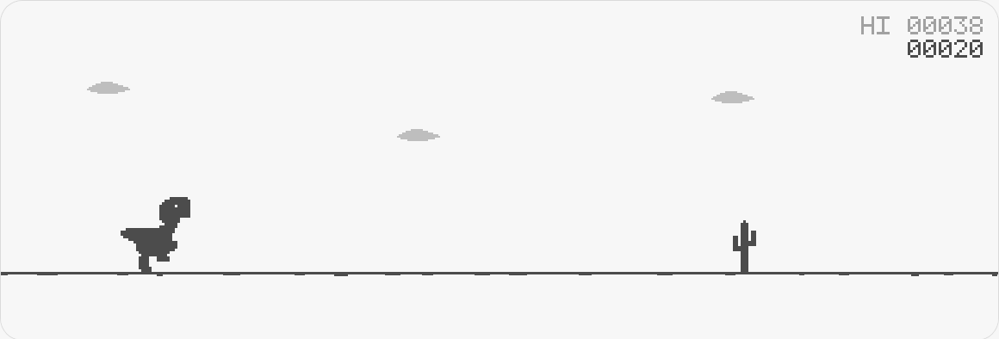

# Dino Runner

A tiny, dependency-free endless runner in the spirit of the Chrome dino game. Pure
HTML, CSS and canvas — no build step, no frameworks, no external assets. Drop the
folder on any static host and it plays.



## Play

| Action | Keyboard | Touch |
| --- | --- | --- |
| Start / retry | `Space` · `↑` · `Enter` | tap the game area |
| Jump (hold longer = higher) | `Space` · `↑` · `W` | **JUMP** button |
| Duck / fast-fall | `↓` · `S` | **DUCK** button |
| Pause | `P` · `Esc` | **PAUSE** button |
| Mute | `M` | **SOUND** button |

The run speeds up as your score grows, pterodactyls join in after 300 points, and
the palette flips to night every 700 points. Your best score is kept in
`localStorage`, so it survives reloads.

## Run it locally

No install, no build:

```bash
# option 1 — python is everywhere
python3 -m http.server 8080

# option 2 — node
npx serve .

# option 3 — just open the file
xdg-open index.html
```

Then visit <http://localhost:8080>.

## Deploy it

Everything is static, so any host works. The whole site is `index.html`,
`styles.css`, `js/` and `favicon.svg`.

- **GitHub Pages** — push the folder to a repo, then *Settings → Pages → Deploy from
  branch → main / (root)*.
- **Netlify** — drag the folder onto <https://app.netlify.com/drop>.
- **Vercel** — `npx vercel` in this folder (framework preset: *Other*).
- **Cloudflare Pages** — connect the repo, leave the build command empty, output
  directory `/`.
- **Anything else** — copy the files to any web server. No SPA rewrites needed.

## How it works

| File | Purpose |
| --- | --- |
| `index.html` | Page shell, canvas, buttons, accessible live region |
| `styles.css` | Page chrome; the palette is driven by `--bg` / `--ink`, which the game updates during the day/night fade |
| `js/sprites.js` | Pixel art as ASCII grids (`#` = ink, `o` = eye hole). Add a sprite by adding another grid |
| `js/game.js` | Parsed sprites, 5×7 pixel font, physics, spawning, collisions, HUD, audio |

Design notes:

- The canvas is rendered in CSS pixels at `devicePixelRatio` (capped at 2) and every
  sprite is drawn at an integer scale `U`, so it stays crisp without image assets.
- `U` follows both the stage width and height, and the base speed follows the stage
  width, so reaction time and jump arcs stay fair from phone to desktop.
- The day/night cycle lerps two RGB palettes; the page background follows along via
  CSS custom properties.
- Jump height is variable: releasing early cuts vertical velocity.
- Sound is synthesised with the WebAudio API — no audio files.

### Tuning

The knobs live at the top of `js/game.js`:

```js
BASE_SPEED = clamp(W * 0.42, 190, 560); // px per second
GRAVITY = 830 * U;
JUMP_V = 292 * U;                       // roughly 0.7s of airtime
```

Night starts at 700 points, the run caps out at ~1500 points of speed ramp, and
pterodactyls appear after 300. All three are single constants in `update()` /
`spawn()`.

## Notes

The art is original pixel art made for this project; the game is an homage to the
Chrome offline dino, not affiliated with Google. Do whatever you like with the code.
